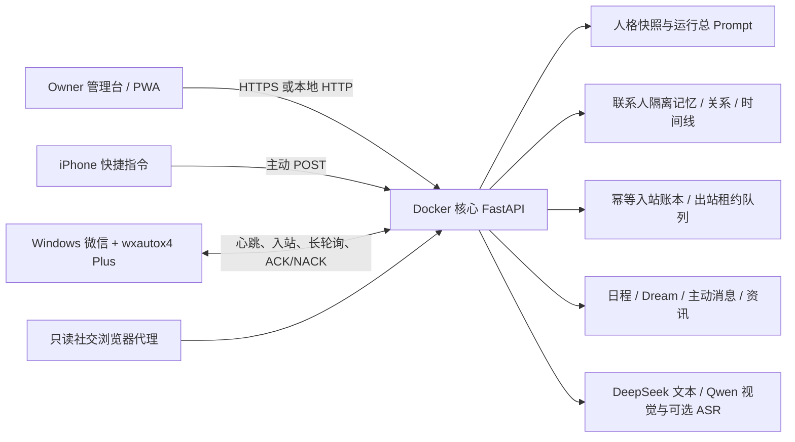

# Soul Mate

Soul Mate 是一个以“角色像真实的人一样持续生活和建立关系”为目标的陪伴系统。它不是把一段人设塞进普通客服机器人：每个人物有自己的事实、表达习惯、生活状态和边界；每位白名单好友又有严格分开的聊天、记忆、画像和关系进度。

当前同时收尾 Windows Docker、Owner 管理台、机器人核心、`wxautox4 Plus` 双微信链路和 iPhone 17 PWA。纪雨已经完成一次真实文字闭环；杜佳颖未登录时只暂缓她的真实微信实发，人物审查、管理台、记忆和 PWA 继续进行。双账号浸泡、两人物第四轮候选人工审核、媒体实测和 iPhone 真机仍需 Owner 配合验收。

## 当前验收配置

第一次接线前请先按 [首次微信跑通与全部配置指南](docs/FIRST_RUN_CONFIGURATION.md) 检查。该文档列出了所有 API Key、模型、管理台位置和管理员 PowerShell 命令。

当前批准绑定如下；任一窗口身份校验失败时，对应账号必须保持停用：

| 人物 | 微信窗口昵称 | 机器人微信号 | 你的微信备注 | 内部账号 ID |
| --- | --- | --- | --- | --- |
| 杜佳颖 | `Sakino` | `Sakino411` | `VIOLET` | `du-jiaying` |
| 纪雨 | `Locin` | `Theonlywan1` | `VIOLET` | `ji-yu` |

管理台为 `http://127.0.0.1:8080`，本地验收账号 `admin`、密码 `123456`。主动消息与朋友圈当前全部关闭；真实双账号文字、媒体、重启和浸泡测试通过后，才在管理台按人物、按联系人开启。

`admin / 123456` 只适合当前本机验收。切换到 VPS 前必须改成强密码，并使用 `OWNER_PASSWORD_HASH`。

## 能实现什么

- 两阶段自然对话：隐藏决策器先决定意图、边界、关系影响和记忆候选，自然语言渲染器再写最终微信文本；回复正文不再被固定 JSON 模板束缚。
- 发送前真人感复核：只拦截 Owner 明确否定且能可靠识别的模式，包括严肃场景乱笑、客服套话、普通聊天编号总结和模型化“不是……而是……”。命中后独立重写一次，仍不合格就不发送，不做机械词语替换。
- 多轮上下文：保留最近真实消息、当前连续消息聚合、近期摘要和相关长期记忆。文字、图片和语音转写在同一轮内无论先后都会合并理解；多模态轮次和“你是说今天吗”这类承接上一问的澄清句会额外经过语境审查，漏答、模糊追问或说话人错位不会直接发送。
- 验收隔离：微信 canary 可用 `-ValidationMode` 正常生成并实发，但不写正式历史、记忆、关系或人格演变证据。为保证连续测试能听懂上一轮，核心只在当前进程内保留最多 20 条、30 分钟的临时上下文，停止或重启即消失。
- 小截图识别：微信压缩后尺寸过小的图片会先放大、锐化再交给视觉模型；文字密集截图优先 OCR 标题、栏目和重点。视觉摘要属于可能出错的观察，联系人对图片的明确说明始终优先。
- 联系人隔离：所有对话、画像、长期记忆、关系指标、主动消息和 PWA 接续都携带 `contact_id`，不会把甲的私聊召回给乙。
- 人格版本：素材、证据、审核结论、当前快照、历史快照和回滚相互分开；“总 Prompt”只在运行时注入，不写进人物快照。
- 独立关系发展：用户要求“立刻成为恋人”或“以后按我指定的性格”只作为对话事件，不会直接改数据库里的关系阶段或人格。
- 八层长期记忆：`core / daily / diary / gallery / songlist / plans / tutorials / handoff` 均有联系人隔离、来源追踪和召回权重；检索综合 SQLite FTS、本地 BGE-M3、时间、重要性与情绪强度。
- Dream 整合：夜间把即将过期的日常碎片消化成值得长期保留的日记型记忆，其余噪声自然过期；不是把所有聊天永久堆进 Prompt。
- 微信文字、图片、自定义表情和 Unicode 表情；图片进入核心后先由视觉模型描述，再参与对话。
- 微信语音：优先在 Plus 回调存活期间立即调用 `VoiceMessage.to_text()`，以明确的“语音转写”文本进入对话，识别失败时不会让角色猜测内容。
- 主动生活：Docker 调度器统一维护日程、情绪、生活片段、主动聊天和低频朋友圈，避免宿主机再维护第二套人格状态。
- 外界信息：支持 RSS、X 官方 API，以及隔离的只读社交浏览器代理读取 X/小红书；外部网页一律当不可信资料，不能覆盖系统指令。
- iPhone 状态：通过快捷指令主动上传电量、充电、当前 App、城市级位置、步数、睡眠和心率摘要；按设备授权过滤并限期保留，不接收精确经纬度，不作医疗诊断。
- 本地/VPS 双部署：平时可完全在本机 Docker 中运行，不买 VPS；以后可迁移核心到 VPS，Windows 只保留微信和 Plus。

## 总体架构



唯一事实源是 Docker 核心的数据目录。宿主机桥接只做五件事：找到指定微信窗口、监听白名单会话、立即保存图片/表情/语音转写、领取待发送动作、回报明确成功或失败。它不生成回复、不维护感情值，也不自行跑主动消息循环。

## 技术栈与目录

| 位置 | 技术/职责 |
| --- | --- |
| `main.py` | Python、FastAPI、Uvicorn、APScheduler；启动 API、聚合工作进程和统一调度器 |
| `api/` | DeepSeek 兼容文本客户端、Qwen 兼容视觉与音频接口 |
| `core/` | 两阶段对话、运行设置、联系人运行时、外部信息、设备上下文、日志和节奏 |
| `persona/` | 素材证据、人格声明、快照、审核、版本与演变约束 |
| `memory/` | 日程、内在状态、分层记忆、Dream 整合与混合召回 |
| `bridge/` | SQLite 联系人、入站幂等、连续消息批次、附件、发送租约、ACK/NACK、朋友圈状态机 |
| `scheduler/` | 日常 tick、主动联系、夜间整合和作业账本 |
| `host_bridge/` | Windows Plus 薄代理实现；不进入 Docker 运行 |
| `scripts/` | 初始化、备份、纪雨配置、微信启动、社交代理和 VPS 切换脚本 |
| `web/routes/` | 管理台按领域拆分的 API 路由 |
| `web/frontend/` | React 18、TypeScript、Vite、TanStack Query 管理台与 `/chat` PWA |
| `data/` | 每个人物的 SQLite、附件、日志、设备数据、本地模型缓存和注册表 |
| `deploy/vps/` | Caddy、VPS Compose、环境变量模板和迁移说明 |

Docker 使用 Node/Python 多阶段构建：Node 只在构建阶段生成静态前端；最终镜像运行 Python 3.11 和已经构建好的静态文件。向量检索默认使用本地 `BAAI/bge-m3`，第一次真正加载会下载模型到 `data/models/`，之后随持久目录复用；下载或加载失败时仍有 FTS 关键词检索，不会调用不存在的 DeepSeek Embedding。

## 人格、关系和记忆如何工作

### 人格不是一段会被聊天改写的 Prompt

素材先进入审核队列，保留来源、正文、提取结论和证据。聊天素材只影响私聊表达，朋友圈素材只影响公开表达和生活形象。审核后生成可预览差异的新快照，激活才会成为运行基线；旧版本始终可回滚。

当前活动版本为杜佳颖 v7、纪雨 v10。纪雨 v8、v9、v10 是 Owner 误点形成的完全相同版本，管理台会折叠展示，保留活动的 v10，不冒险删除历史。旧候选和所有人工评分都保留为证据，低分回复不会进入表达示例库。

根据逐条评分、断句/称呼修正，以及 Owner 对咨询对话和理想伴侣方向的确认，杜佳颖 v11 的 40 条已全部评价为“像真人”，达到严格门槛但尚未激活。纪雨 v13 的 46 条已全部评价，其中 45 条“像真人”、1 条“人机感明显”；系统据此生成 v14，只把“又累又饿还不想动”的回复改为两条完整意思：`那先点个吃的` / `吃完再说`，其余 45 条和评分逐字沿用。纪雨 v14 仍包含对已授权问卷和咨询内容的知情、自然后续关心、正确的死亡焦虑理解、平等成熟的伴侣方向与女性化表达接纳。v14 只剩这 1 条待复审，必须全部评价且“人机感明显”为 0 才允许激活；85% 不再是放行门槛。详细结论见 [2026-08-10 真人感审查决策](docs/PERSONA_REVIEW_DECISIONS_2026-08-10.md)。

管理台“日志与设置”中的总 Prompt 是独立运行配置，适合填写全局安全边界或表达偏好。它不属于任何人物快照，不会污染人格审核和版本差异。

### 每位好友都有自己的关系世界

人物的身份、日程和生活世界线全局共享；每位好友单独保存：

- 最近真实对话与摘要；
- 对此人的画像和事实；
- 八层联系人记忆与每层来源追踪；
- 信任、亲密、好感、舒适度、积怨和关系阶段；
- 主动消息许可、时段、冷却、每日上限；
- PWA 是否接续这份关系。

管理台可以纠正或归档错误记忆，但不能手工伪造恋爱阶段。新联系人加入白名单后默认能得到回复，但默认不接收主动消息；Owner 必须在该联系人卡片里单独开启。

## 模型与媒体能力

### 文字

默认模型为 `deepseek-v4-pro`，隐藏决策和最终表达可以在管理台分别指定模型。DeepSeek V4 当前公开 API 文档只列文字输入、JSON 输出和工具调用，因此本项目不把图片或音频直接发给 DeepSeek。

### 图片

默认使用阿里云百炼 OpenAI 兼容接口的 `qwen3.7-flash`。Plus 在回调中立即下载微信图片，核心保存附件并让视觉模型生成描述；文字模型只看到描述和附件来源。没有视觉 Key 时图片仍会入库，但角色不会假装看懂。

### 语音

微信语音优先使用已经购买的 Plus 自带 `to_text()`，无需额外模型费用。管理台还保留 `qwen3-asr-flash` 配置，供未来 PWA 语音或普通音频文件转写；它可沿用识图的百炼 Key，也可填写独立 Key。

所有密钥都可在“日志与设置 → 人物的模型与外界信息”中修改。卡片顶部有“杜佳颖”“纪雨”两个醒目的按钮；先点人物，再保存或测试文字、识图、语音和资讯。文字、视觉、语音、RSS 与 X 官方 API 按人物隔离；社交浏览器代理、PWA Token、Tailscale、主动联系默认值和 VPS 地址属于全局基础设施。密钥在 `data/platform/runtime_settings.db` 中使用 Fernet 加密，接口只返回“已配置/未配置”，不会把原文传回浏览器。数据库设置优先于 `.env`，新请求立即生效；`.env` 只保留首次启动和灾难恢复默认值。

当前两个人物的文字和识图连接已经实际测试成功；语音服务的鉴权与模型列表也成功，仍需用一段真实微信/PWA 音频完成最终转写验收。现在无需重新填写这三类 Key，除非管理台测试后来显示失效。

## 从零部署本地 Docker

### 前置条件

- Windows 10/11，Docker Desktop 已启动；
- 微信客户端已登录，运行期间桌面不能锁屏；
- Python 3.12 用于宿主机 Plus，Node 只在本地前端开发时需要；
- 一份在当前 Windows 机器上激活的 `wxautox4 Plus`；
- DeepSeek API Key；需要识图时再准备阿里云百炼 Key。

### 1. 配置

```powershell
Copy-Item .env.example .env
```

至少确认 `WECHAT_BRIDGE_TOKEN`、`PWA_CHAT_TOKEN` 和加密主密钥。模型 Key 可在管理台按人物保存。桥接 Token 至少 24 位且不能与 PWA Token 相同。当前灾难恢复映射为：

```dotenv
WECHAT_ACCOUNTS_JSON=[{"account_id":"du-jiaying","nickname":"Sakino"},{"account_id":"ji-yu","nickname":"Locin"}]
WECHAT_ACCOUNT_CONFIG_FALLBACK=false
ADMIN_DEFAULT_CHARACTER_ID=ji-yu
WECHAT_PROACTIVE_ENABLED=false
```

日常绑定由管理台和 Docker 账号目录提供。只有核心目录暂时不可用且你手动把 `WECHAT_ACCOUNT_CONFIG_FALLBACK` 改为 `true` 时，桥接才读取这份完整双账号映射；缺少任一窗口昵称会直接停止，不会回退到别的微信窗口。

不要把 Plus 激活码写进 `.env`、管理台、日志或聊天。

### 2. 启动核心

```powershell
docker compose up -d --build
docker compose ps
Invoke-RestMethod http://127.0.0.1:8080/healthz
```

任何本地代码修改后都要再次执行 `docker compose up -d --build`。`data/` 以绑定卷挂载，重建容器不会删除人物、聊天、记忆和发送队列。

### 3. 检查当前人物和数据库

```powershell
python .\scripts\check_db.py
```

该检查会递归验证当前 8 个 SQLite 数据库，而不只检查根人物库。创建一致性恢复点使用 `python .\scripts\backup_db.py`；结果和恢复要求见 [备份与恢复](docs/BACKUP_RECOVERY.md)。

不要重新运行旧的单账号初始化脚本覆盖当前绑定。登录管理台逐一确认人物版本、VIOLET 白名单、PWA 接续和微信账号卡；核心日常配置以管理台与人物注册表为准。

### 4. 安装和激活 Plus

```powershell
python -m venv .venv-host
.\.venv-host\Scripts\python.exe -m pip install -r requirements-host.txt
.\.venv-host\Scripts\wxautox4.exe auth check --json
$plusActivationCode = Read-Host '请粘贴 Plus 授权码'
.\.venv-host\Scripts\wxautox4.exe auth activate $plusActivationCode
Remove-Variable plusActivationCode
```

`Read-Host` 会让你在 PowerShell 中粘贴授权码，授权码不会直接出现在命令历史里；不要把它发给 Codex、写进 `.env` 或管理台。不同 Python 虚拟环境可能各自显示授权状态；以项目 `.venv-host` 的 `auth check` 为准。购买一份 Plus 足够在同一台已授权 Windows 机器上顺序管理多个微信窗口，不需要为每个人设单独购买。

### 5. 启动微信薄桥接

第一次必须先只读预检：

```powershell
.\scripts\start_wxautox_bridge.ps1 -CheckOnly -AccountId ji-yu
```

它只从核心读取纪雨的批准绑定并检查 `Locin` 窗口，不监听、不读取消息、不发送。只有 `window_ready` 为 `true` 且管理台账号卡完全对应时，才运行 `.\scripts\start_wxautox_bridge.ps1 -AccountId ji-yu -ValidationMode` 开始单账号 canary。验收模式仍实发回复，但不污染正式历史、记忆、关系和人格演变；正式使用时停止后去掉该参数。杜佳颖对应参数是 `du-jiaying`；两个账号分别通过后，才去掉 `-AccountId` 启动双账号。代理为每个账号保存独立入站 SQLite 缓冲，共享一把微信 UI 锁；Docker/VPS 暂时离线时，已捕获消息可在恢复后继续上传。

纪雨已于 2026-08-09 完成第一条真实文字闭环：`VIOLET → Locin` 的入站、模型生成、出站租约、发送和 ACK 全部成功，宿主缓冲清空且没有重复动作。首条短问候等待偏长的问题已经修正；“在吗、有空吗、睡了吗、忙吗、方便吗”在生成完成后的额外自然延迟最多 18 秒。下一步仍建议按顺序验证连续三到五条短消息、一张图片、一段短语音和桥接重启，再开启更长时间浸泡测试。

2026-08-11 已把此前 canary 的输入、回复、图片附件、记忆和关系变化从纪雨正式数据中清除，并恢复为测试前的初识关系；可恢复副本位于本地备份目录。之后的 canary 必须使用 `-ValidationMode`。桥接还会关闭 wxautox4 默认的正文 DEBUG 文件日志，只保留不含聊天正文的技术日志。

## 一份 Plus 与两个微信

一份 Plus 可以在同一台已授权 Windows 电脑上管理两个已登录微信窗口，不需要为两个人物再买一份。每个窗口是独立代理实例、独立心跳、独立状态目录和独立核心数据库，但微信 UI 操作必须串行；如果将来把两个微信分到两台电脑，第二台电脑才需要自己的授权。完整接线和验收顺序见 [微信 Plus 子文档](docs/WECHAT_PLUS.md)。

## Owner 管理台

管理台保持五个直观区域：

1. 运行总览：Docker、人物、待审核素材、队列和错误概况；
2. 人设与素材：看原文、系统理解和证据，执行保留/排除/修正/拆分，查看当前人格、历史版本、差异、暂停和回滚；
3. 白名单联系人：确认 Plus 发现的会话，查看每个人独立的关系/记忆/时间线，设置 PWA 接续和主动消息频率；
4. 微信与媒体：桥接心跳、积压、图片、表情、朋友圈状态与功能降级；
5. 日志与设置：运行总 Prompt、模型与 API Key、RSS/X/小红书、iPhone 健康数据授权、主动默认值和备用 VPS 地址。

### 管理台视觉与手机使用

管理台使用 A+C 混合界面：侧栏和状态卡使用分层 Liquid Glass，审核正文、日志和表单内容保持高对比度实色底，避免整页模糊。桌面显示侧栏，平板显示可关闭抽屉，宽度较小时底部显示五个主区域入口；人物切换始终在导航顶部，不会把杜佳颖和纪雨的配置混在一起。

管理台外层和页面滚动链统一采用 `100vh`，顶部/底部只使用 safe-area 内边距；不会把聊天 PWA 的 `100dvh` 或固定 body 规则带入管理台。玻璃不支持时会自动退回不透明卡片，动效使用 transform/opacity 并遵守 `prefers-reduced-motion`。如果手机仍出现白边，先清除主屏幕旧图标后重新添加，并确认访问的是管理台根路径而不是 `/chat`；完整的 iPhone 检查表见 [管理台与 PWA 手机验收](docs/PWA_IPHONE.md)。

“备用 VPS 地址”只保存和展示目标，不能在浏览器里一键切换数据库。真正切换必须先停旧核心、迁移最新数据、再启动新核心，避免两边同时写同一世界线。

## PWA 与 iPhone

推荐先用 Tailscale 创建仅自己 tailnet 可见的 HTTPS 入口：

```powershell
.\scripts\configure_tailscale_serve.ps1
```

先在“日志与设置 → PWA 与 iPhone 私网访问”生成并保存至少 24 位的 PWA Token。再在 iPhone 登录同一 tailnet，用脚本输出的 `https://...ts.net/chat` 打开并输入该 Token。Token 只在生成时显示，保存后不回显原文。PWA 使用独立 `/chat` 外壳和统一 `100vh` 高度链；微信与 PWA 接续同一联系人关系，但 PWA 回复不会进入微信发送队列。完整真机检查见 [iPhone PWA 子文档](docs/PWA_IPHONE.md)，从安装 Tailscale 到创建快捷指令的逐步操作见 [iPhone 快捷指令与手机数据](docs/IPHONE_SHORTCUT.md)。

### 手机状态和健康数据

在管理台创建设备并勾选愿意分享的数据类型，复制生成的请求配置到 iPhone 快捷指令。建议用“充电、打开指定 App、每天早中晚”作为自动化触发，手机每次只主动推送一个快照，服务器保留当天变化而不是覆盖最新值。

数据包括电量、充电、时间、设备名、当前 App、城市级位置，以及明确授权的步数/睡眠/心率摘要。默认只保留 7 天，可在管理台调整。系统可以据此自然关心作息，但不能诊断疾病，也不能把数据提供给其他联系人。当前还没有创建设备或收到 iPhone 数据，这不影响微信文字测试。

## 外界信息与社交平台

最稳的来源是 RSS；X 官方 API 需要 Bearer Token。小红书和需要登录态的 X 页面使用 `ai-social-browser` 思路改造成只读宿主代理：人工登录常驻浏览器，核心只允许 feed/search/profile/read，模型即使在网页里看到“忽略之前指令”也不能执行。RSS、X 官方 API、真人浏览器和网上图片是四条独立链路，当前差异见 [外界信息能力与配置边界](docs/EXTERNAL_INFORMATION.md)。

```powershell
.\scripts\start_social_browser_proxy.ps1 -Install
```

然后在管理台填写代理地址和强随机 Token，再分别开启“只读 X”或“只读小红书”。登录、验证码和风控挑战必须人工处理；不自动绕过验证，不允许点赞、关注、回复、转发或发布。Chrome 调试端口、8272/8273 原始动作端口绝不能暴露公网。

管理台“微信与媒体 → 保存网上找到的图片”可以把公开 HTTPS 图片连同来源页面、平台、用途和说明保存到待审核区。用于私聊时可以选择“私聊世界线图片”：系统内部仍保留真实来源，但聊天中不会机械强调“这是网上找的”，可作为角色分享生活、地点或话题的视觉素材；该模式不能用于朋友圈。审核通过后，决策器能看到当前联系人可用的图片摘要，并在语境合适时自动选图加入微信 outbox；没有匹配项就只发文字。从小红书/X 自动捕获图片候选仍是后续工作。

## VPS 与不买 VPS 的影响

完全可以一直用本机 Docker，不购买 VPS。代价是电脑关机、休眠、锁屏或 Docker/微信退出时：管理台、PWA、定时任务和微信收发都会停止。已经写入 `data/` 的人物、关系、记忆和队列不会因正常重启丢失；恢复后先启动 Docker，再确认微信登录且桌面未锁定，最后启动 Plus 桥接。

VPS 模式只把核心、管理台、PWA、数据库和调度器搬到公网 Linux；Windows 微信和 Plus 仍必须在线才能收发微信。这样电脑关闭时管理台、PWA、手机数据、资讯刷新和 Dream 仍运行，但微信收发暂停。

完整的准备、迁移、HTTPS、切换、回滚和关机影响见 [VPS 子 README](deploy/vps/README.md)。常用脚本：

```powershell
.\scripts\prepare_vps_bundle.ps1
.\scripts\migrate_to_vps.ps1 -SshTarget 'root@服务器' -VpsUrl 'https://你的域名' -IUnderstandOnlyOneCoreMayWrite
.\scripts\set_core_mode.ps1 -Mode Local
```

## 测试与验收

自动化基线以本次最终测试输出为准，前端类型检查和生产构建也必须同时通过。自动测试不能替代微信窗口、iPhone 真机和双账号浸泡验收。

```powershell
python -m pytest -q -p no:cacheprovider
Set-Location web\frontend
npm run typecheck
npm run build
Set-Location ..\..\..
docker compose up -d --build
docker compose ps
```

微信实机至少覆盖：

- 连续 5 条短消息只聚合生成一次；文字＋图片＋语音无论先后只生成一次并整合全部信息；
- 文字自然拆为 1–3 条，不出现客服式套话；
- 图片和语音能被正确理解，失败时不瞎猜；
- 相同入站事件、桥接重启和重复轮询不产生重复回复；
- 两位联系人长期测试时零串话；
- 表情或朋友圈选择器故障不影响普通文字；
- 电脑/Docker/桥接重启后已落库队列可以恢复。

对话真人感还需人工盲评。聊天语料只作为弱风格参考，不能驱动当前情绪；笑声必须先符合场景，消息拆分由语义和发送节奏决定，不能为了短句而把完整语义拆碎。

### 当前前端视觉基线

管理台和 `/chat` 共用暖沙色、琥珀色和高对比文字令牌。管理台在桌面使用玻璃侧栏，在小屏使用抽屉与五区底部导航；聊天页按微信的消息分组逻辑组织气泡，使用磨砂玻璃而不是绿色气泡。两个入口都把外层高度固定为 `100vh`，safe-area 只用于内部留白，避免 iOS PWA 底部白边。

PWA 历史不是固定截断：首次载入最近一页，向上滚动会按稳定游标加载更早消息，并通过滚动高度补偿保持阅读位置。完整聊天仍保存在服务端联系人账本中，浏览器只缓存最近 300 条用于离线启动。

## 常见问题

| 现象 | 检查与处理 |
| --- | --- |
| Docker 不健康 | `docker compose ps`、`docker logs --tail 100 soul-mate-core`；确认 8080 未占用、`data/` 可写 |
| 管理台账号无效 | 本地 Compose 的最终账号应为 `admin / 123456`；执行 `docker compose config` 确认后重建。VPS 不允许继续用此弱密码 |
| 管理台中文在旧 PowerShell 里乱码 | 浏览器先确认；Windows PowerShell 5 读取无 BOM UTF‑8 时需显式 `-Encoding UTF8`，日志和源码不要改回 GBK |
| `auth check` 显示 false | 必须使用项目 `.venv-host\Scripts\wxautox4.exe auth activate`；在其他 Python 环境激活不一定被这里识别 |
| 找不到微信窗口 | 展开两个主窗口并运行 `start_wxautox_bridge.ps1 -CheckOnly`；杜佳颖必须是 `Sakino`，纪雨必须是 `Locin`，不能用人物名或 `VIOLET` 代替 |
| 找不到 VIOLET | 让会话出现在最近列表，在管理台“白名单联系人”确认候选会话；不要再运行旧单账号初始化脚本 |
| 文字能聊但图片不懂 | 在管理台填写百炼 Key，确认视觉模型 `qwen3.7-flash`，检查附件大小和微信回调下载是否成功 |
| 微信语音没反应 | 确认心跳能力含 `voice_to_text`；Plus 版本需提供 `VoiceMessage.to_text()`，转写为空时系统会安全跳过 |
| DeepSeek 报错 | 检查 Key、余额、Base URL 和模型名；对话模型只处理文字，不要把图片二进制直接交给它 |
| 首次对话很慢 | 本地 BGE-M3 可能正在下载/加载；模型缓存完成后会复用，期间 FTS 仍可工作 |
| 主动消息误发风险 | 新联系人默认关闭；在联系人卡片逐人设置许可、时段、冷却和每日上限，不要只依赖全局默认 |
| 社交平台出现验证 | 停止自动读取并人工完成登录/验证；不绕过风控，不开放浏览器调试端口到公网 |
| 电脑重启后不回复 | 依次确认 Docker 健康、微信已登录、Plus 已激活、桥接进程已重启、管理台心跳在线 |

## 备份、安全与隐私

- 迁移和人格大改前先用 `scripts/backup_db.py` 或 SQLite Backup API 备份；脚本同时保存人物附件与审核语料，但排除 Cookie、日志和模型缓存。不要只复制正在写入的数据库文件。
- `.env`、运行设置数据库、聊天数据库、附件、设备令牌和备份都按私密数据保护。
- 入站使用事件 ID 和稳定哈希幂等；出站使用租约、ACK/NACK。发送结果不确定时标记 `delivery_unknown`，禁止盲目重发。
- 日志显式 UTF‑8、滚动保存，只记事件摘要和短 ID，不应记录完整聊天、完整 Prompt 或明文密钥。
- 朋友圈采用 `prepared → dispatching → published / delivery_unknown / failed`，真实发布必须先对测试标签做一次人工授权验收。

## 进一步阅读

- [VPS 部署、切换与回滚](deploy/vps/README.md)
- [首次微信跑通与全部配置](docs/FIRST_RUN_CONFIGURATION.md)
- [杜佳颖与纪雨真人感第二轮审核](docs/PERSONA_REVIEW_ROUND2.md)
- [2026-08-10 真人感审查决策与第四轮候选](docs/PERSONA_REVIEW_DECISIONS_2026-08-10.md)
- [微信 Plus 双账号接线与验收](docs/WECHAT_PLUS.md)
- [管理台日常操作](docs/OWNER_CONSOLE.md)
- [iPhone 17 PWA 安装与真机验收](docs/PWA_IPHONE.md)
- [iPhone 快捷指令与手机数据接入](docs/IPHONE_SHORTCUT.md)
- [Tailscale 私网 HTTPS](docs/TAILSCALE.md)
- [RSS、X、小红书与网络图片说明](docs/EXTERNAL_INFORMATION.md)
- [备份、恢复与升级](docs/BACKUP_RECOVERY.md)
- [实现决策与接口说明](../IMPLEMENTATION.md)
- [当前已完成状态](../STATUS.md)
- [剩余工作和验收标准](../PLAN.md)
- [DeepSeek 模型与价格](https://api-docs.deepseek.com/quick_start/pricing/)
- [Qwen 视觉模型](https://help.aliyun.com/zh/model-studio/vision-model/)
- [Qwen ASR](https://help.aliyun.com/zh/model-studio/asr-model/)
- [wxautox4 Plus 文档](https://docs.wxauto.org/docs/example.html)
